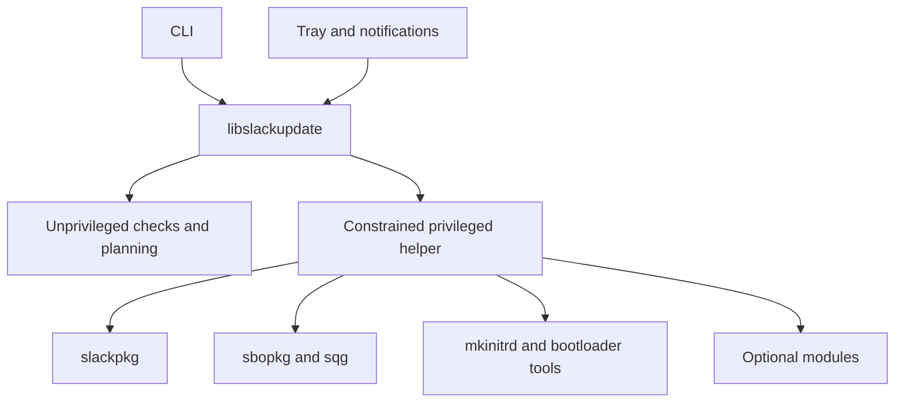

# Planned C application design

This document collects the existing product and C design plan formerly embedded
in the README. It is a design reference, not an implementation or an approved
native operational composition. The original detailed reference contracts retain
their scope; this extraction does not amend them.

The shell reference is available today. The C port, library, helper, tray and
packaging are future work behind the [Phase 1 gate](roadmap.md#current-phase-and-release-gate).
See the [current README](../README.md) for the supported source-tree entry point
and [CONTRIBUTING.md](../CONTRIBUTING.md) for development rules.
The [historical README](reference/readme-through-step418.md#goals) retains the
original full text, including earlier checkpoints and reference implementation notes.

## Implementation boundary

| Area | Available reference or planned application |
| --- | --- |
| Update engine | Shell reference in `tools/reference/slack-update-reference.sh` |
| Configuration | Current shell schema 1 in `data/config/slack-update.conf` |
| Structured outputs | Current JSON and NDJSON schema 0, marked provisional |
| Process exit codes | Stable 0-8 reference contract; see the [README](../README.md#exit-codes) |
| C library, CLI and helper | Planned; no C build system selected |
| Tray, notifications and desktop preferences | Planned |
| Version 1 result schema and release | Pending the reference completion gate |

The shell reference describes behavior to preserve during a later port. This
role does not replace the independent evidence/oracle requirements of the
[operational contracts](reference/phase-1-operational-joint-unselected-a-r-d-decision-brief-review.md).

## Goals

- Provide a reliable and understandable update workflow for Slackware.
- Support Slackware 15.0 and Slackware-current as first-class release targets.
- Keep system updates independent from optional components such as SBo, Cinnamon, and Flatpak.
- Allow every optional module to be enabled, disabled, or automatically detected.
- Provide both graphical and command-line frontends over the same core logic.
- Run the tray application as an unprivileged user.
- Request elevated privileges only for operations that require them.
- Produce human-readable logs and machine-readable results.
- Detect partial updates, broken ELF dependencies, boot preparation failures, and reboot requirements.
- Avoid systemd-only assumptions.
- Make update behavior testable without modifying the host system.

## Supported Slackware targets

Slack-Update must support both:

- **Slackware 15.0**, the supported stable-release baseline;
- **Slackware-current**, the rolling development branch.

Compatibility with both targets is a release requirement, not a best-effort goal.
Reference acceptance tests, the future C implementation, packaging, and installation
documentation must cover both systems. A feature that is only available on one target
must be detected explicitly and must not silently break the other target.

## Non-goals for the first release

- Implement a replacement for `slackpkg`, `sbopkg`, Flatpak, or bootloader tools.
- Provide transactional package management that Slackware itself does not provide.
- Load third-party binary plugins through a public runtime ABI.
- Support every Slackware-compatible package manager in version 1.0.
- Perform unattended package installation by default.
- Require a graphical environment for CLI or headless use.

The first release will use an internal module interface. A stable external plugin ABI may be designed later, after the internal API has proved reliable.

## Design principles

1. **Fail safely**
   A failed Slackware update, initrd generation, or bootloader update must prevent unsafe follow-up actions.

2. **Detect before acting**
   Every module follows a common lifecycle: probe, check, plan, apply, verify, and report.

3. **Optional means optional**
   Missing Cinnamon, Flatpak, SBo, GRUB, or any other optional component must not be treated as a global application failure.

4. **No hidden root session**
   The tray process must never run permanently as root.

5. **One source of truth**
   The CLI, tray application, and privileged helper must use the same core data model and status definitions.

6. **Deterministic operation**
   Package selection, queue generation, dependency ordering, and result reporting must not depend on filesystem enumeration order or ambiguous text parsing.

7. **No systemd dependency**
   Scheduling, startup, logging, and privilege handling must remain compatible with standard Slackware installations.

8. **Observable execution**
   Every phase must expose progress, warnings, errors, logs, and a final structured result.

## Planned components

| Component | Purpose | Privileges |
|---|---|---|
| `libslackupdate` | Core state model, configuration, modules, planning, command execution, and reporting | Unprivileged by default |
| `slack-update` | Command-line frontend | Unprivileged for checks; elevation for changes |
| `slack-update-helper` | Short-lived privileged executor for approved operations | Root only while needed |
| `slack-update-tray` | System tray icon, status, actions, and desktop notifications | Unprivileged |
| Reference shell script | Executable specification and regression oracle during the port | Root for apply operations |

## High-level architecture

The diagram represents the planned C application. It does not select native
enforcement, IPC, storage or clock primitives for the unresolved operational work.



The existing plan prefers D-Bus plus PolicyKit where available. A root CLI mode
must remain available for installations without a graphical authorization agent.
Core logic, module registration, planning and results are shared by frontends;
the tray remains unprivileged and elevation is limited to required operations.

## Module lifecycle

Every update module should implement the same conceptual lifecycle:

1. `probe` — determine whether the module is available and applicable.
2. `check` — inspect repositories and local state without applying changes.
3. `plan` — return the exact actions, dependencies, risks, and required privileges.
4. `apply` — perform the approved changes.
5. `verify` — confirm that the expected final state was reached.
6. `report` — return structured status, counts, warnings, errors, and reboot requirements.

Planned module states:

- `disabled`
- `unavailable`
- `idle`
- `checking`
- `update-available`
- `planned`
- `running`
- `success`
- `warning`
- `failed`
- `skipped`
- `reboot-required`

## Planned modules

### Slackware module

The Slackware module is the only core update module enabled by default.

- Run `slackpkg update`.
- Detect and optionally apply `install-new`.
- Detect and optionally apply `upgrade-all`.
- Stop secondary modules after a partial Slackware update.
- Snapshot the package database before and after changes.
- Determine exact package names that changed.
- Detect critical library and kernel changes.
- Expose update counts and package lists to the frontends.

### SBo module

Optional module for systems using `sbopkg` and `sqg`.

- Auto-detect `sbopkg`, `sqg`, and their configuration.
- Synchronize the configured SBo repository.
- Detect potential updates for installed SBo packages.
- Rebuild installed SBo packages after configured ABI changes.
- Map broken ELF objects to owning SBo packages.
- Generate one deterministic dependency-ordered queue.
- Preserve per-package build options.
- Stop on the first build failure by default.
- Verify repaired binaries after rebuilding.

### ELF dependency module

Optional diagnostic module, enabled automatically when the required tools are available.

- Inspect ELF objects statically without executing them.
- Prefer `lddtree` when available.
- Provide a `readelf`-based fallback.
- Resolve `RPATH`, `RUNPATH`, `$ORIGIN`, architecture, and loader cache entries.
- Avoid duplicate scans of the same real file.
- Record the unresolved library for every affected object.
- Map affected files to installed package manifests.

### Boot module

Optional module activated by relevant kernel changes.

- Detect the installed kernel and package changes.
- Validate `/etc/mkinitrd.conf` before running `mkinitrd`.
- Verify that the configured kernel has installed modules.
- Generate and validate the initrd.
- Refuse bootloader changes when initrd preparation fails.
- Stage and validate bootloader configuration before replacing it.
- Preserve a backup of the previous configuration.
- Report a clear **do not reboot** condition after critical failures.

Planned bootloader adapters:

- [ ] GRUB
- [ ] ELILO
- [ ] LILO
- [ ] Extensible bootloader adapter interface

GRUB will be the first implemented adapter because it is already covered by the reference script.

### Cinnamon module

Optional module for users who install Cinnamon through CinnamonSlackBuilds.

- Default mode: `auto`.
- Remain disabled when Cinnamon or its configured build repository is absent.
- Synchronize the configured CSB repository.
- Detect repository changes independently of Slackware ABI changes.
- Trigger a rebuild after relevant graphical ABI changes.
- Run the configured Cinnamon build command.
- Report the exact reason for a rebuild.

### Flatpak module

Optional module for systems that use Flatpak.

- Default mode: `auto`.
- Update system Flatpaks independently from user Flatpaks.
- Discover eligible local users safely.
- Allow an explicit user allowlist or denylist.
- Report failures per installation and per user.
- Do nothing when Flatpak is not installed or the module is disabled.

### Notification module

Desktop-only module.

- Notify when updates are available.
- Notify when an update completes.
- Notify when an update fails.
- Notify when a reboot is recommended or required.
- Avoid repeated notifications for the same update set.
- Support configurable urgency and notification categories.
- Never display privileged command output without sanitization.

### Scheduler module

Optional scheduling support without requiring systemd.

- Periodic checks from the tray process.
- Optional cron integration for headless systems.
- Configurable interval and quiet hours.
- Network availability checks before repository access.
- Single-instance locking shared with manual executions.
- No automatic application of updates unless explicitly enabled.

## Planned configuration and desktop preferences

The current reference parser and defaults are in
[slack-update-reference.sh](../tools/reference/slack-update-reference.sh) and
[slack-update.conf](../data/config/slack-update.conf). It uses `[slackware]`,
`[sbo]`, `[elf]`, `[boot]`, `[cinnamon]` and `[flatpak]` sections alongside the
core/package settings. Unknown sections and keys are rejected.

The following is the ORIGINAL PROPOSED final configuration shape, retained as
planned design. **Do not install it as the current shell reference configuration.**
The `[module.*]` sections, notifications and desktop settings below are not its
current accepted configuration format.

Proposed per-user preferences path:

```text
${XDG_CONFIG_HOME:-$HOME/.config}/slack-update/preferences.conf
```

```ini
[core]
check_interval_minutes=60
automatic_checks=true
automatic_apply=false
log_retention_days=30
minimum_free_mib=4096

[module.slackware]
mode=enabled
install_new=true
upgrade_all=true

[module.sbo]
mode=auto
rebuild_on_abi_change=true
stop_on_failure=true
options_file=/etc/slack-update/sbo-options.sqf

[module.elf]
mode=auto
scan_after_system_update=true

[module.boot]
mode=auto
bootloader=auto
update_initrd=true

[module.cinnamon]
mode=auto
repository=/var/lib/slack-update/csb
branch=master

[module.flatpak]
mode=auto
update_system=true
update_users=true

[notifications]
enabled=true
notify_available=true
notify_completed=true
notify_failed=true
notify_reboot=true
```

The existing plan still requires system policy to be separate from per-user
presentation preferences, explicit schema compatibility, and future
`slack-update config validate` and `slack-update config dump-effective` commands.
Those command forms are not available in the shell CLI.

## Planned results and events

The final result and event APIs must serve both CLI and tray clients. The
following original schema-1 example is a proposal, not the current JSON output
or a frozen version 1 schema:

```json
{
  "schema_version": 1,
  "operation": "apply",
  "success": true,
  "partial": false,
  "reboot": "recommended",
  "boot_safe": true,
  "started_at": "2026-01-01T10:00:00Z",
  "finished_at": "2026-01-01T10:15:00Z",
  "modules": {},
  "warnings": [],
  "errors": []
}
```

Progress should be exposed as events so that the CLI and tray application can display the same execution:

- operation started;
- module started;
- module progress changed;
- action started;
- log message emitted;
- warning emitted;
- error emitted;
- reboot state changed;
- module completed;
- operation completed.

The current reference provides `--json` for one final document and `--events`
for NDJSON progress. They are mutually exclusive, reserve standard output and
redirect human-readable progress to standard error and the log. Both use
`schema_version: 0` and `schema_status: "provisional"`.

Current events include sequence, UTC timestamp, operation, event type, module,
action, state, message and optional exit code. Detailed progress percentages
and log-message events remain planned. Stable process exit codes remain the
separate [0-8 contract](../README.md#exit-codes); provisional schemas do not
change their meanings or successful reboot-guidance codes.

## Planned source organization

| Path or area | Intended contents |
| --- | --- |
| `include/`, `src/core/`, `src/config/`, `src/execution/` | Public/internal types, core, configuration and execution layer |
| `src/modules/` | Slackware, SBo, ELF, boot, Cinnamon, Flatpak, notification and scheduler modules |
| `src/cli/`, `src/helper/`, `src/tray/` | Frontends and privilege boundary |
| `data/` | Configuration, icons, desktop files, D-Bus/PolicyKit and translations |
| `docs/` | Architecture, configuration, module API, security and testing documentation |
| `tests/` | Unit/integration tests, fixtures, mocks and system scenarios |
| `tools/reference/` | Existing shell reference and validation tools |
| `packaging/slackware/` | Future SlackBuild, package description and installation script |

This is a proposed organization. These future C and packaging paths are not an
inventory of existing directories. The build system remains unselected; final
layout may change while preserving separation of core, modules, frontends,
helper, tests and packaging.

## Security requirements

- [ ] The tray application never runs as root.
- [ ] The helper exposes only predefined operations.
- [ ] External commands are executed without a shell unless strictly necessary.
- [ ] Paths crossing the privilege boundary are canonicalized and validated.
- [ ] Temporary files use safe creation APIs and restrictive permissions.
- [ ] Symlink attacks are considered for every privileged file operation.
- [ ] Configuration writable by normal users cannot alter privileged command paths.
- [ ] Repository URLs and executable paths have explicit trust rules.
- [ ] Logs do not expose secrets or sensitive environment data.
- [ ] Update locks cover CLI, tray, cron, and helper operations.
- [ ] Boot files are validated before activation.
- [ ] The UI clearly distinguishes warnings from unsafe-to-reboot failures.

## Coding standards

- Use English for source-code identifiers, comments, commit messages, documentation, and developer-facing logs.
- Keep user-facing strings translatable.
- Prefer explicit ownership and cleanup rules.
- Avoid global mutable state where practical.
- Keep modules independent from graphical code.
- Do not parse command output when a stable file or API is available.
- Treat external command output as untrusted input.
- Compile with strict warnings.
- Add tests with every bug fix.
- Keep commits focused and buildable whenever practical.

## Versioning

The project should use semantic versioning after public interfaces begin to stabilize.

- `0.x.y` — architecture and feature development; interfaces may change.
- `1.0.0` — first stable CLI, configuration schema, helper protocol, and documented module behavior.
- Patch releases must not make incompatible changes to stable machine-readable interfaces.

Planned compatibility surfaces:

- [ ] Configuration schema.
- [ ] CLI commands and options.
- [ ] Exit codes.
- [ ] JSON result schema.
- [ ] D-Bus/helper protocol.
- [ ] Module identifiers.
- [ ] External plugin ABI, only if introduced later.

## Definition of version 1.0

Slack-Update 1.0 will be ready when:

- [ ] Slackware 15.0 and Slackware-current are both covered by the applicable acceptance matrix.
- [ ] Slackware updates can be checked and applied safely from the CLI.
- [ ] Optional SBo, Cinnamon, Flatpak, ELF, and boot modules can be independently configured.
- [ ] Missing optional software does not cause unrelated failures.
- [ ] The tray application reports available updates and operation progress.
- [ ] Desktop notifications work without running the tray as root.
- [ ] Privileged operations use a constrained helper or documented root CLI mode.
- [ ] Results are available in stable human-readable and JSON formats.
- [ ] Partial updates and boot failures are clearly identified.
- [ ] The complete reference acceptance matrix passes.
- [ ] Automated unit and integration tests pass with GCC and Clang.
- [ ] A Slackware package and SlackBuild are available.
- [ ] Installation, configuration, recovery, and security behavior are documented.
