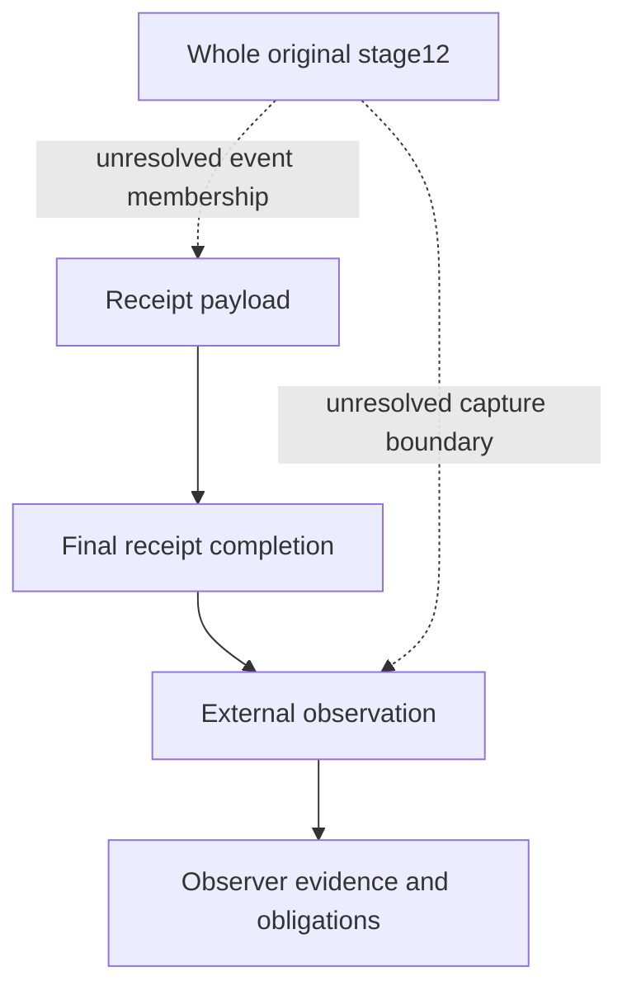

# Phase 1 step 384: whole stage12 and external receipt causality

This is a repository decision review in the finite379–388 plan. Actual383 was
accepted at reported45f463f with239 exact ordered PASS, nine files4597 insertions,
eight creates, successful6c65757..45f463f push and reported clean matching heads.
The complete uploaded21694 UTF8 bytes are bound without normalization. Full actual
commit ID and independent terminal/GitHub/host inspection are unavailable. This
step remains prepared, not accepted, and grants no implementation or native test.

## Original requirement and unresolved causal boundary

The whole original stage12 is publish-reviewed-result/function
publish_evidence_and_receipt. Its complete original operation, guards, effects,
failure boundary, seams, stdout, stderr and exit-record roles remain unchanged in
original316_whole_stage12. Whole original320–327/347/348/365/372/377 requirements
remain normative; this focus does not amend them. Exact original316 publication
requirements,347 trace/evidence and all other input documents remain byte and
canonical-bound through the whole378 freeze and31 supplied JSON inputs.

The original archive contains stages0–11, cleanup and publication preparation;
the external last receipt is separate and commits last. Record, archive, sidecar,
receipt, final receipt observation and consumer handoff have separate outcomes.
The whole final-stage raw streams/status/origin obligation cannot be shortened
or renamed to fit an easier cutoff. The immutable receipt payload cannot claim
to have independently observed the later final commit/storage completion of that
same payload, nor contain its own final hash as proof of independent completion.
These are original project requirements and conditional design deductions, not a
new theorem of universal protocol or hash impossibility.

An external final observation is necessary under the original contract but its
name or position does not establish a solution. The actual stage start/end, event
membership, stream/status collection cut, payload construction, native commit,
directory/storage proof and observer evidence effects are unknown. In particular,
the paper external order below does not decide whether every actual receipt or
collector event belongs to the original stage, nor reconcile complete original
stage evidence. No actual finite observation/custody protocol is selected. An
assertion that no infinite receipt chain is needed is not native proof.

## Bounded compositions

| Candidate | Disposition and unsatisfied original obligation |
| --- | --- |
| self-observed-final-receipt | incompatible-as-stated: Its proposed payload depends on a later completion event of that same final payload; the original contract forbids this self-observation as independent evidence. |
| archive-contains-own-final-receipt | incompatible-as-stated: This contradicts the original separate external last receipt and stages0-11/cleanup/preparation archive role; self-reference does not establish independent origin or completion. |
| renamed-or-shortened-stage12 | incompatible-as-stated: Moving the stage label or dropping required original events waives the whole original final-stage obligation; an acyclic subset cannot prove native conformance. |
| publisher-summary-or-hash-as-oracle | incompatible-as-stated: No complete authenticated raw evidence, actual source/capability/writer independence or supported final object/storage observation is established. |
| visible-pair-or-ACK-as-completion | incompatible-as-stated: Original separately committed objects, independent directory/storage evidence and consumer ACK/custody are distinct; unknown completion does not authorize replay or erase failure. |
| uncontrolled-external-observer | incompatible-as-stated: External location/role is not independence or effect authority; observer writes and descendants require original controls, while publication consumes captured closed data only. |
| whole-stage12-external-boundary-hypothesis | unresolved: Actual stage start/end/event membership, collector cut, receipt payload/commit/storage observations and complete closed-data causal refinement are unselected. |
| complete-independent-custody-hypothesis | unresolved: Actual source/provenance/actor capability/clock/storage/right lifetimes, fault effectiveness and two-platform independent raw evidence remain unknown. |

Six incomplete compositions are incompatible AS STATED; two complete hypotheses
remain unresolved. This does not reject every use of hashes, collectors, storage
APIs or external observers. All accepted380–383 enforcement/writer/owner-loss/
clock/drain/original-storage/finite-rights obligations remain full blockers.

## Actor and event questions

| Paper role | Required future review; no actual actor selected |
| --- | --- |
| stage12-subject | Complete original publish_evidence_and_receipt entry/end/effects, every raw stdout/stderr/status and sticky original failure; exact stage membership unresolved, never shortened. |
| independent-stream-collector | Complete original stage12 stream/status/origin capture including descendants, partial/lost evidence and collector own writes; protected source/FD/transport/writer independence required. |
| external-last-receipt-writer | Separate original captured-data receipt payload, exact artifact identities/hashes, stage12 evidence and origin; final own commit/hash/durability never self-observed payload fields. |
| independent-final-receipt-observer | Independently bind exact final receipt object/bytes/metadata/commit/directory/storage outcome after relevant completion, own finite rights/evidence effects and trusted origin; no native cutoff selected. |
| evidence-custody-consumer | Exact controlled revalidation of archive/sidecar/receipt and original attempt/status/origin through durable handoff, ACK and continued writer/alias controls; recipient ownership alone not immutability. |
| independent-verifier-and-expectations | Independently expected original full raw vectors before comparison, protected comparison source and authentic raw data; verifier may author expectations, subject cannot self-author its sole oracle. |
| independent-fault-controls | Fresh separately authorized bounded effective native fault controls with independent positive and negative observations; own injector effects not exempt, no test currently authorized. |

Every role has unknown actual numeric identity/namespace/privilege, source and
dependency graph, finite authority, FD/transport/writer lifetime and raw origin/
storage observation. Native independence and current authority are false. Role
names and different digests cannot establish independence. No artificial separate
person requirement: the independently reviewed verifier may author expectations;
the subject cannot self-author the sole trusted oracle for its own behavior.

Eight event questions separately retain null actual actor, original stage membership,
native boundary, raw bytes/status/origin, commit/storage and finite-rights bindings.
The two small dependency graphs supplied to the pure reviewer classify paper cycles
only. One self-observation proposal has payload→same-final-completion→payload, a
cycle of the claimed prerequisites. The external question is acyclic but does not
establish its completeness, native happens-before order or whole stage12 conformance.

This shows an unresolved review question, not an implemented stage cutoff or
selected native graph. The external observer also has source, descendants, streams,
evidence/ACK writes, storage, trust and original finite rights obligations. Collector
loss or uncertain own evidence preserves scoped pending obligations; it cannot be
exempted because it is outside the subject or generate self-authority via its receipt.
No worker service/broker FD, RPC, new target grant or renewed rights are introduced.

## Conditional schedules and scoped uncertainty

- self-completion-dependency: receipt-payload-prepared → same-payload-final-commit-storage-required → prior-payload-claims-later-own-observation. Conditional dependency contradiction of the proposed own-observation claim, not a mathematical impossibility theorem for all hashes or all protocols.
- self-archive-dependency: archive-payload-prepared → same-archive-final-hash-required → last-receipt-in-same-archive-proposed. Keep exact original external receipt and distinct archive role; no self-containing completed archive claim.
- stage-boundary-shrink: original-whole-stage12-obligation → receipt-events-omitted-or-renamed → subset-declared-complete. No label or cutoff amendment can discharge whole original stage12.
- stream-EOF-status-gap: one-stream-EOF → other-stream-descendant-or-raw-status-unknown → whole-stage-completion-proposed. Independently retain every complete raw stream/status and original attempt/provenance; EOF of one stream is not complete evidence.
- self-summary-origin-gap: publisher-emits-PASS-hash → independent-origin-and-effect-capture-unknown → oracle-success-proposed. Subject summary/hash/role name never supplies independent complete native proof.
- record-archive-sidecar-split: record-known → archive-known → sidecar-commit-or-storage-unknown → atomic-pair-proposed. Preserve distinct outcomes; no atomic pair inference or replay.
- last-receipt-ACK-loss: receipt-may-have-committed → ACK-lost → republish-or-unused-right-proposed. Exact actual receipt outcome null/scoped pending; preserve artifacts and no reuse, without inventing definitely absent or completed.
- receipt-storage-cut: receipt-visible → receipt-directory-or-storage-outcome-unknown → external-observation-required. Separate final object/commit/storage proof under independently reviewed observer controls; a paper boundary is not the native protocol.
- observer-evidence-loss: collector-captures-subject → collector-evidence-write-or-ACK-unknown → collector-closure-proposed. Collector own effects/rights and surviving children remain scoped pending; no exempt observer or infinite self-receipt chain claimed as a solution.
- recipient-alias-drift: artifact-hash-checked → recipient-ancestor-content-writer-drift → consumer-reopen-proposed. Exact checked-to-consumed object/bytes/origin and writer lifetime controls required through reviewed handoff.
- handoff-ACK-loss: consumer-may-have-read-exact-artifacts → durable-handoff-ACK-unknown → received-or-global-closure-proposed. No received/closed inference, republish or new target grant; consumer own effect outcome separate.
- post-release-live-reread: target-evidence-captured-under-guard → target-release-known → publisher-live-target-refresh-proposed. Captured closed data only; publication cannot reacquire target or repair target obligations.
- contained-failure-relabel: original-forward-failure → independently-known-containment → complete-failure-publication-hypothetically-known → original-result-relabelled-success. Complete contained-failure evidence differs from original transaction success; no pause/right grant or erased mismatch.
- observer-owner-loss: publisher-or-collector-owner-loss → possible-descendant-FD-stream-or-storage-survivor → full-completion-proposed. Known full descendant/effect drain and original finite gates required; loss never proves absence/closure.

These fourteen schedules are conditional paper questions, not native fault runs,
effective injections, exhaustive crash cuts or new original native cases. Sixteen
candidate×platform rows remain unobserved independently for15.0 and current; no
borrowed support/version/storage/identity or historical native result. Eight full
criteria and eight actual enforcement boundary questions remain unresolved.

Whole374 eleven target closure rows, nine publication sequence rows, sixteen
failure-cut rows and seven uncertainty domains are retained unchanged. Whole375
role/trust rows and all twelve raw-group reviews remain unchanged. Whole323 closure/
clock/fence,324 guard/publication,325 publication,326 model/oracle and327 crossclosure
clauses remain unchanged, plus the whole377 causal conflict and original316stage12.
These projections do not replace the bound complete documents or limit their scope.

Target evidence and sealed captured data precede known scoped target release under
all applicable original gates: continuous full writer guard, known descendants and
in-flight effects, original identity/backups/approved deltas, safe restoration or
independently proven no-write original equivalence, finite same-attempt rights. The
original target/owned/controller/publication distinctions remain. Publication consumes
captured closed data only, never live target refresh/reopen/restore/backend calls
after release. Publication failure grants no reacquire, replay, target cleanup or
forward renewal. Known target closure never implies global/controller closure.

Archive and sidecar are separate exclusive no-replace commits, not an atomic pair.
Each known identity/bytes/metadata/commit/directory/storage state remains separate
from final receipt and consumer handoff. SHA is not authenticity or authority.
Matching bytes do not prove origin, checked-to-used lifetime, stable ancestors,
recipient/ACL/alias/content writers or actual supported storage. Target guard release
does not supply publication controls; recipient ownership does not prove immutability.
Any occupied destination forbids overwrite/removal/recreate/rebind.

Unknown raw status is null, unattempted is not success, stderr/stream gaps are not
empty. Independently known complete contained-failure publication must retain original
raw failure and any known mismatch; pending never erases it. Lost receipt or consumer
ACK does not imply no effect or completed handoff. Preserve partial artifacts and
original finite consumed/uncertain rights unavailable; no retry/republish/refund/new
grant. External observation of final receipt completion remains separate from payload.
Every collector/verifier/consumer/injector effect requires its own full original review,
independent raw expectations and fault effectiveness; no exemption or native authority.

## Validation and limits

The pure reviewer imports hashlib/json/re and validates supplied values only, including
whole predecessor receipt, authored policy, all input bytes/canonical JSON, copied
original clauses and conditional dependency questions. It has no filesystem, clock,
network, spawn, service or native dispatcher. Tests reject invented event membership,
stage shortening, actor independence/authority, own-completion evidence, relaxed
observer scope, replay, original failure rewriting and fabricated native readiness.
Local graph tests exercise cycle/schema handling; acyclic data never grants proof.

Complete1993 accepted repository files survive unchanged except additive CHANGELOG;
eight new artifacts/nine scoped changed paths, accepted README exact. Git-visible
inventory includes tracked ignored files and preserves local ignored outputs, solely
for repository scope, not actual host absence. Historical harness383 runs on the
unchanged accepted383 snapshot; expanded384 additions must not loosen its old gate.

No external platform fact is asserted in this review: the single primary register
identifies supplied whole project requirements and distinguishes conditional inference.
Actual source/actor/native storage/capture/trust/oracle/causal refinement remains null.
Full eight320–327 contracts, sixteen347 sections/sixteen348 gaps,46 qualified proofs,
52 native cases,12 raw groups,1072 proof-case relations,365 sixteen prerequisites/
thirty-two platform rows,372 ten blockers and377 eight conflicts/ten future-test-entry/
five later-operational prerequisites remain normative. Safe independently reviewed
containment and fresh explicit bounded native-test grant must precede future tests;
passing such a test cannot grant its own permission. Full independent two-platform
conformance remains later operational readiness. No test, component or experiment
authorized here. Phase1/kernel incomplete; v1schema/reference-v1/C/Phase2/Production
closed. Actual host unobserved-not-claimed-absent/live bindingsnull/global closurefalse.

After complete actual384 application/tests/exact commit/push/clean matching heads,
385 reviews the whole actual source/backend graph and independent oracle. Then386
integrated bounded verdict,387 README/roadmap,388 full freeze/all nine original scoped
pause conditions plus complete actual final receipt. Last confirmed pause378 covers
369–378 repository only. Conditional388 is not confirmed now; then STOP/no automatic389.
